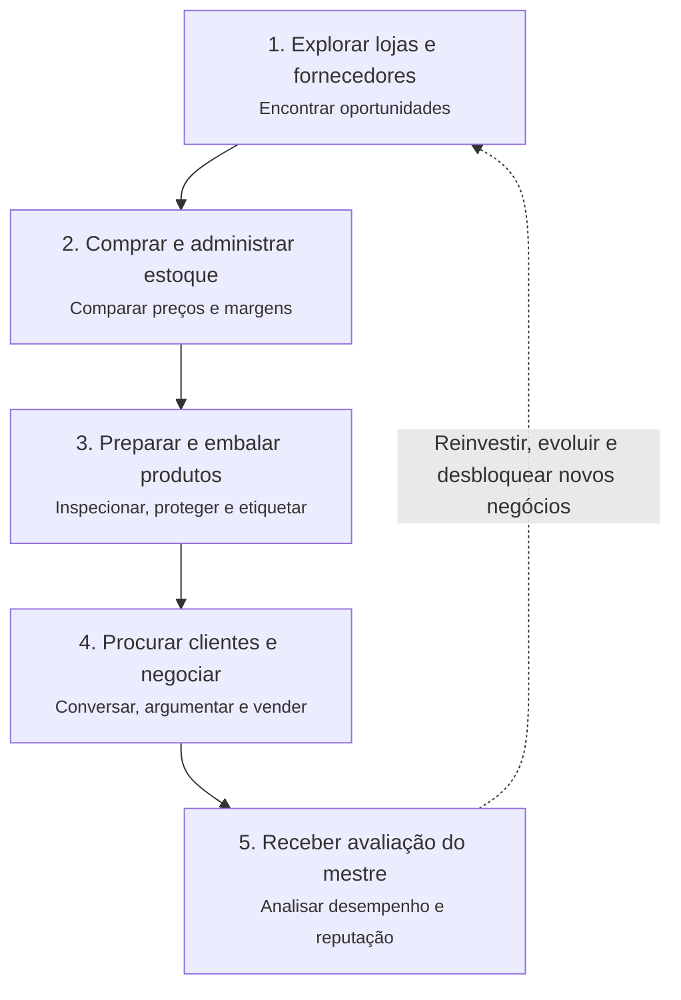
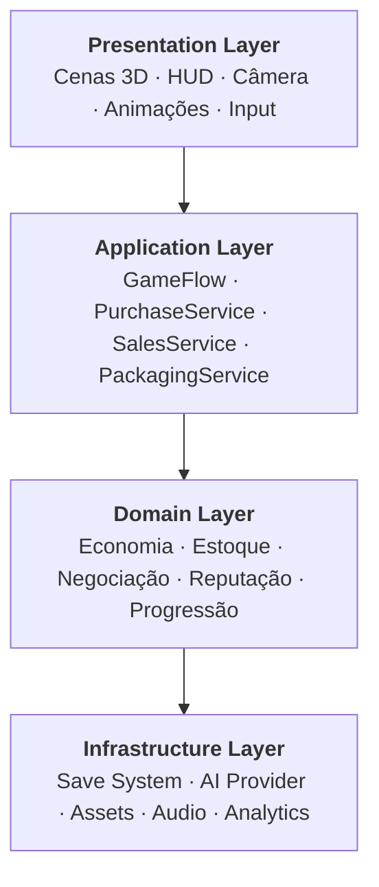

# PROJETO MESTRE — SIMULADOR 3D DE NEGOCIAÇÃO E EMPREENDEDORISMO

**Engine:** Unity 6  
**Plataformas:** Windows (PC) e Android  
**Gênero:** Simulação econômica, comércio, negociação, gerenciamento e exploração 3D  
**Perspectiva:** Primeira pessoa, com opção de terceira pessoa futuramente  
**Estilo visual:** Realista, moderno, imersivo e com ambientes interativos  
**Modo inicial:** Single-player, com NPCs inteligentes  
**Nome provisório:** DealMaster — Business Simulator

A proposta é criar um jogo em que o jogador começa como um pequeno comerciante, com capital limitado, e precisa construir seu negócio comprando mercadorias, descobrindo oportunidades, negociando com fornecedores, preparando produtos, procurando compradores e fechando vendas.

O jogo deve ter a sensação de um simulador de vida comercial, e não de um aplicativo de perguntas e respostas. Cada ação importante acontece dentro de um ambiente 3D.

## 1. Conceito central

O ciclo principal de jogabilidade será:



O jogo terá uma economia consistente: dinheiro, estoque, custos, despesas, reputação, experiência comercial, nível do negócio e desbloqueios.

**Princípio fundamental:** o jogador deve conseguir perder uma venda, ficar com mercadoria parada, negociar um excelente preço, cometer erros de embalagem, receber reclamações e até ter prejuízo. Essas consequências tornam o comércio interessante.

---

# 2. Prompt mestre para a IA desenvolvedora

O texto abaixo foi estruturado para ser utilizado em uma IA de programação com acesso ao projeto Unity, como um agente de desenvolvimento que consiga criar e modificar arquivos, executar builds e corrigir erros.

➡️ O prompt completo está em [`PROMPT_MESTRE.md`](PROMPT_MESTRE.md).

---

# 3. Arquitetura técnica do projeto Unity 6

O mais importante é que o jogo não seja construído como um único script gigantesco. Vamos separar os sistemas para que possam evoluir sem quebrar o restante.



## Estrutura de diretórios

```text
Assets/
└── _DealMaster/
    ├── Art/
    │   ├── Characters/
    │   ├── Environments/
    │   ├── Products/
    │   └── Materials/
    ├── Audio/
    ├── Prefabs/
    │   ├── NPCs/
    │   ├── Shops/
    │   ├── Products/
    │   └── Packaging/
    ├── Scenes/
    │   ├── Bootstrap.unity
    │   ├── MainMenu.unity
    │   ├── CommercialDistrict.unity
    │   └── TestEnvironment.unity
    ├── ScriptableObjects/
    │   ├── Products/
    │   ├── Suppliers/
    │   ├── NPCProfiles/
    │   └── Progression/
    ├── Scripts/
    │   ├── Core/
    │   ├── Player/
    │   ├── Economy/
    │   ├── Inventory/
    │   ├── Suppliers/
    │   ├── Packaging/
    │   ├── Negotiation/
    │   ├── NPC/
    │   ├── Mentor/
    │   ├── Progression/
    │   ├── Persistence/
    │   └── UI/
    ├── Tests/
    │   ├── EditMode/
    │   └── PlayMode/
    └── Settings/
```

## Scripts principais e responsabilidades

| Script | Responsabilidade |
|---|---|
| `GameBootstrap.cs` | Inicializar serviços e carregar dados |
| `PlayerController.cs` | Movimentação e câmera |
| `InteractionController.cs` | Detectar e usar objetos |
| `ProductDefinition.cs` | Definição dos produtos |
| `InventoryService.cs` | Entrada, saída e reserva de estoque |
| `WalletService.cs` | Controle financeiro |
| `SupplierService.cs` | Catálogos, compras e reposição |
| `PurchaseService.cs` | Validar e executar compras |
| `PackagingController.cs` | Minigame de embalagem |
| `CustomerBrain.cs` | Necessidades e comportamento do cliente |
| `NegotiationEngine.cs` | Propostas, confiança e aceitação |
| `DialogueService.cs` | Conversas contextuais |
| `SalesService.cs` | Conclusão de vendas |
| `MentorEvaluator.cs` | Avaliação da negociação |
| `ProgressionService.cs` | Experiência e desbloqueios |
| `SaveGameService.cs` | Salvamento e carregamento |
| `GameHUDController.cs` | Atualização da interface |

O sistema financeiro será a fonte única da verdade. Uma conversa com NPC nunca poderá adicionar dinheiro ou mercadorias diretamente.

---

# 4. Scripts C# iniciais

Três scripts-base reais, para iniciar a implementação. Eles não representam o jogo inteiro, mas estabelecem a estrutura de produtos, dinheiro e negociação.

| Script | Caminho |
|---|---|
| `ProductDefinition.cs` | [`Assets/_DealMaster/Scripts/Inventory/ProductDefinition.cs`](../Assets/_DealMaster/Scripts/Inventory/ProductDefinition.cs) |
| `WalletService.cs` | [`Assets/_DealMaster/Scripts/Economy/WalletService.cs`](../Assets/_DealMaster/Scripts/Economy/WalletService.cs) |
| `NegotiationEngine.cs` | [`Assets/_DealMaster/Scripts/Negotiation/NegotiationEngine.cs`](../Assets/_DealMaster/Scripts/Negotiation/NegotiationEngine.cs) |

- **ProductDefinition:** os valores monetários são armazenados em centavos inteiros, evitando erros comuns de arredondamento com `float`.
- **WalletService:** para a versão definitiva, as operações de compra e venda serão coordenadas por um serviço transacional, garantindo que a atualização do dinheiro e do estoque aconteça como uma única operação lógica.
- **NegotiationEngine:** protótipo de decisão econômica. O sistema definitivo também considerará necessidades, confiança, objeções, histórico e personalidade. A função retorna uma pontuação de aceitação entre 0 e 1. Ela não conclui a venda automaticamente: a decisão final deve considerar o estado da negociação, a estratégia do NPC e uma fonte de aleatoriedade controlada para permitir testes reproduzíveis.

---

# 5. Progressão do jogador

A progressão deve dar a sensação de começar pequeno e realmente construir uma empresa.

| Faixa | Título | Conteúdo |
|---|---|---|
| Níveis 1–5 | 🛍️ **Vendedor iniciante** | Acessórios, utilidades, pequenos fornecedores e vendas individuais. |
| Níveis 6–10 | 🏪 **Revendedor profissional** | Eletrônicos, descontos por volume, depósito maior e clientes recorrentes. |
| Níveis 11–20 | 🏢 **Empreendedor** | Loja própria, contratos comerciais, funcionários e novas categorias. |
| Níveis 21–30 | 🏭 **Empresário** | Atacado, logística, múltiplos pontos de venda e clientes corporativos. |
| Nível 31+ | 👑 **Magnata comercial** | Rede de negócios, grandes negociações e desafios avançados do mestre. |

Essas faixas são uma proposta inicial de balanceamento, não valores definitivos.

---

# 6. Primeira versão jogável — Vertical Slice

A primeira entrega deve ser um pequeno jogo completo, e não um mapa enorme com sistemas incompletos.

**Configuração inicial proposta — "Primeiro dia de negócios"** _(protótipo)_

| Capital inicial | Produtos | Fornecedores | Perfis de clientes |
|---|---|---|---|
| R$ 1.500 | 10 | 2 | 5 |

**Missão principal:** realizar a primeira venda lucrativa e obter aprovação do mestre negociador.

O jogador sai do depósito, visita um fornecedor, compra um produto, retorna, prepara a embalagem, encontra um comprador e negocia o preço.

## Exemplo de uma negociação dentro do jogo

O jogador comprou um fone de ouvido por R$ 85 e gastou R$ 5 com embalagem. O custo direto é de R$ 90, sem considerar outras despesas.

- Produto: **Fone de ouvido sem fio** — preço de referência R$ 150,00
- Cliente: **Rafael** · perfil econômico
- Lucro direto potencial = proposta − 90
- Interesse estimado = `clamp(0, 100, round(85 − (proposta − 120) × 0,8))`

| Proposta | Reação simulada do cliente |
|---|---|
| até R$ 115 | "Esse preço está interessante. Quero saber mais sobre a garantia." |
| até R$ 145 | "Gostei do produto, mas será que você consegue melhorar um pouco esse preço?" |
| até R$ 170 | "Está acima do que eu pretendia gastar. O que justifica esse valor?" |
| acima | "Está muito caro para o meu orçamento. Vou comparar com outras lojas." |

🎛️ Versão interativa (com slider): abra [`simulador-negociacao.html`](simulador-negociacao.html) no navegador.

_Simulação ilustrativa. No jogo real, a decisão dependerá de vários atributos e não apenas do preço._

## Exemplo de avaliação do mestre

**Negociação concluída — 8,4/10**

| Critério | Nota |
|---|---|
| Argumentação | 90% |
| Conhecimento do produto | 75% |
| Atendimento | 95% |
| Margem de lucro | 70% |
| Ética e transparência | 90% |

_Exemplo ilustrativo de como seria a interface de avaliação dentro do jogo._

---

# 7. Cronograma técnico de desenvolvimento

| Etapa | Entrega | Critério de conclusão |
|---|---|---|
| 1. Fundação | Projeto Unity, URP, controles PC/Android | Personagem explora uma cena |
| 2. Comércio | Produtos, dinheiro, fornecedores e inventário | Comprar e guardar mercadorias |
| 3. Embalagem | Bancada, caixas, fita e proteção | Preparar um pedido fisicamente |
| 4. NPCs | Navegação, perfis e negociação | Cliente aceita ou recusa propostas |
| 5. Vendas | Pagamento, entrega e pós-venda | Ciclo econômico completo |
| 6. Mestre | Histórico, avaliação e feedback | Nota fundamentada por negociação |
| 7. Progressão | XP, desbloqueios e missões | Evolução persistente |
| 8. Finalização | Áudio, otimização, testes e builds | Windows e Android executáveis |

## Requisitos técnicos para PC e Android

A Unity permite compartilhar grande parte do código entre as duas plataformas, mas a apresentação precisa ser adaptada.

| Recurso | Windows | Android |
|---|---|---|
| Movimento | Teclado e mouse | Joystick virtual |
| Interação | Tecla E / mouse | Botões touch |
| Embalagem | Arrastar e manipular | Gestos e toque |
| Gráficos | URP qualidade alta | URP otimizada |
| NPCs | Maior quantidade simultânea | Quantidade limitada |
| IA generativa | Opcional via serviço | Opcional via serviço |
| Salvamento | Dados locais | Dados locais |

A meta inicial pode ser 60 FPS em um PC intermediário e 30 FPS em um Android intermediário, sujeita a testes em hardware real.

## 8. Regras que não podem faltar

- **NPCs com memória:** um cliente deve reconhecer compras anteriores, descontos e experiências de atendimento.
- **Produtos com valor real de mercado dentro da simulação:** não adianta comprar por R$ 100 e vender por R$ 500 sem uma justificativa convincente.
- **Negociação livre:** o jogador pode perder vendas, recusar propostas e negociar sem resultados predeterminados.
- **Embalagem interativa:** materiais, posicionamento e proteção influenciam o resultado.
- **Consequências financeiras:** prejuízo, falta de estoque, despesas e reclamações precisam afetar o negócio.
- **Mestre avaliador:** deve ensinar o jogador a melhorar sua estratégia, não simplesmente premiar qualquer venda.
- **IA offline funcional:** nenhuma mecânica essencial pode depender de uma assinatura de IA.
- **Economia verificável:** nenhuma operação pode duplicar dinheiro ou itens.

---

## Proposta para o desenvolvimento

O projeto é dividido em duas grandes versões.

**DealMaster 0.1 — Primeira venda:** um bairro compacto, compras, inventário, embalagem, negociação, avaliação e salvamento. Essa versão já deve ser divertida e permitir repetir o ciclo comercial.

**DealMaster 1.0 — Vida de empreendedor:** cidade ampliada, lojas próprias, funcionários, entregas, veículos, fornecedores avançados, clientes corporativos, reputação, eventos econômicos e contratos.

A arquitetura e o prompt mestre estão definidos, e os scripts apresentados são a base inicial. Ainda não há um projeto Unity compilado ou executáveis gerados; isso exige criar as cenas, integrar os componentes e validar o jogo no editor.

**A principal decisão de design:** o DealMaster deve ser um simulador de comércio em primeira pessoa, no qual o jogador aprende a negociar pela experiência, e não um jogo de diálogos com respostas certas. É isso que vai diferenciar o projeto.

### Próximos passos sugeridos

- Continuar detalhando `WalletService.cs`
- Iniciar implementação de `PurchaseService.cs`
- Desenvolver `CustomerBrain.cs` básico
